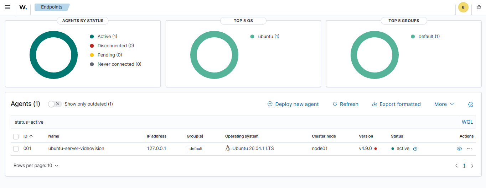
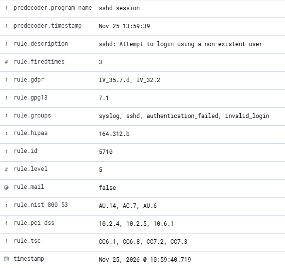
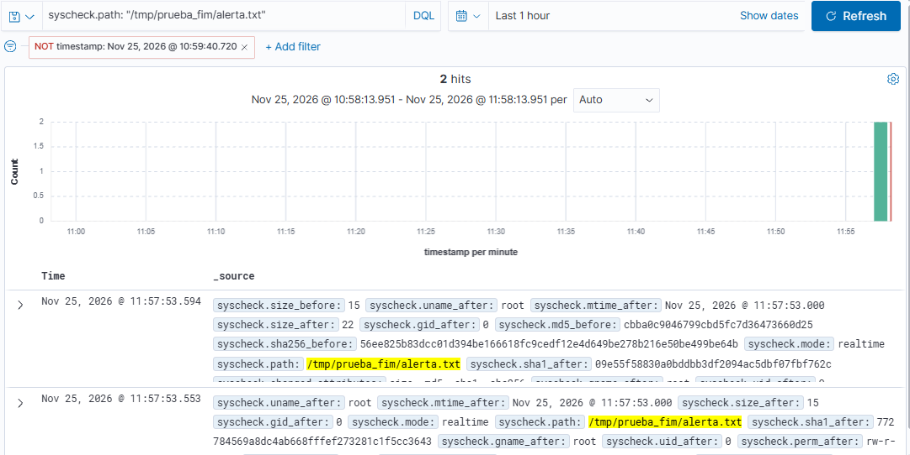

# 01 - Wazuh SOC Monitoring & Host Telemetry Lab

## Contexto y objetivo
Laboratorio práctico de monitoreo defensivo (Blue Team / SOC) desplegado en infraestructura local para detectar intentos de autenticación fallidos por SSH y cambios de integridad en archivos críticos del sistema operativo.

- **Analista / Autor:** Mauricio Lizana (`Mlizanaa`)
- **Perfil:** Técnico en Ciberseguridad | Ruijie RSE SMB Advanced
- **Entorno:** Ubuntu Server con Wazuh en Docker (`wazuh.manager`, `wazuh.indexer`, `wazuh.dashboard`), publicado internamente vía Nginx y resolución DNS local (`wazuh.videovision.cl`).
- **Agente monitoreado:** `ubuntu-server-videovision` (conectado localmente hacia el Manager).

## Evidencias del laboratorio

### 1. Agente activo en el panel de Wazuh
Verificación de conectividad y reporte del agente local `ubuntu-server-videovision` en estado **Active**.

### 2. Detección de intentos de acceso SSH con usuario inexistente
Simulación controlada de intentos fallidos de conexión SSH hacia `127.0.0.1` utilizando un usuario inexistente para validar la ingesta de logs de autenticación y su clasificación en Wazuh.

| Campo | Valor observado |
| :--- | :--- |
| **Rule ID** | `5710` |
| **Rule Description** | `sshd: Attempt to login using a non-existent user` |
| **Rule Level** | `5` |
| **Rule Groups** | `syslog, sshd, authentication_failed, invalid_login` |
| **Cumplimiento** | PCI_DSS (`10.2.4`, `10.2.5`, `10.6.1`), GDPR, HIPAA, NIST_800_53 |

### 3. Monitoreo de Integridad de Archivos (FIM / Syscheck)
Configuración de monitoreo en tiempo real (`realtime="yes"`) sobre el directorio de prueba `/tmp/prueba_fim` y validación de eventos ante creación y modificación de `/tmp/prueba_fim/alerta.txt` (cambio de tamaño de `15` a `22` bytes y actualización de hashes `MD5`, `SHA1` y `SHA256`).

## Lecciones aprendidas y troubleshooting
- **Resolución DNS interna:** Se verificó la resolución de subdominios `.videovision.cl` mediante `dnsmasq` (`/etc/dnsmasq.conf`) y `/etc/hosts` para exponer `wazuh.videovision.cl` de forma limpia.
- **Consulta en Discover vs. Threat Hunting:** Ante un filtro mal formado (`manager.name: undefined`) en la vista de Threat Hunting, se validó la ingesta y el análisis de eventos directamente en **Discover** (`wazuh-alerts-*`).
- **Validación de configuración del agente:** Se respaldó `ossec.conf` antes de modificar `<syscheck>` y se comprobó el ciclo de reinicio del servicio (`wazuh-agent.service`) y la limpieza posterior de `/tmp/prueba_fim`.
